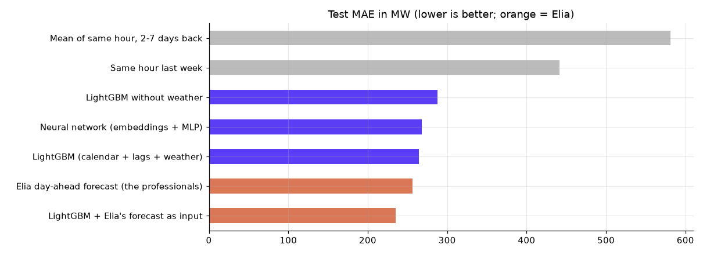
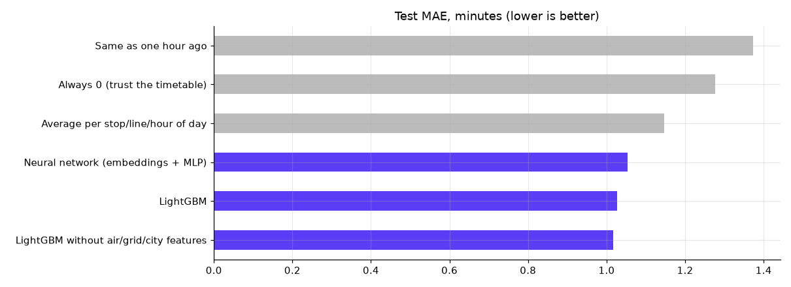
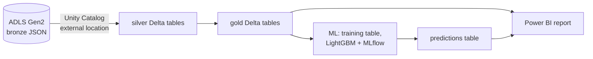

# Brussels transit ML

[](https://github.com/Huntsama/brussels-transit-ml/actions/workflows/ci.yml)

Machine learning on Belgian open data: **beating the grid operator's own electricity forecast** and **predicting
how late Brussels buses, trams and metros run**. Then the same data on an Azure Databricks platform with MLflow,
Kafka streaming and a FastAPI service.

## Results

Every model is tested on later data than it was trained on (time split, no leakage; checked by tests in `tests/`).

**Belgian electricity demand, day ahead** (`grid_load`, Elia data since 2015 + weather). Elia's own forecast is off by
256 MW on average. LightGBM that takes Elia's forecast as one input and corrects it: **235 MW, 8% better**.



**Extra wait at each STIB stop, next hour** (`transit_delay`, 835k stop-hours, 10-26 Oct 2026). LightGBM: **1.02 min**
mean error vs 1.15 for the best rule (average per stop, line and hour), 11% better. Adding air quality, grid and city
features did not help, so the final model leaves them out.



Full studies with plots and error analysis: `outputs/<task>/report.html` (download and open) or
`outputs/<task>/notebook.ipynb` (renders on GitHub).

## What is built, what is in progress

| Part | State |
|---|---|
| ML studies (`tasks/`, `outputs/`, `src/mlkit.py`) | done, reproducible with `bash run.sh <task>` |
| Tests + CI (GitHub Actions, images to ghcr.io) | done, green |
| FastAPI service + Kafka producer (`api/`, `streaming/`) | code, tests and Docker images done |
| Databricks platform in Terraform (`infra/`, `notebooks/`) | written; first deployment pending |
| Power BI report, Databricks lessons | in progress |

## Databricks platform

The data comes from [brussels-lakehouse](https://github.com/Huntsama/brussels-lakehouse): an Azure Function saves
STIB's live waiting times and vehicle positions every 5 minutes, plus air quality (IRCEL) and Belgian grid load
(Elia), into an ADLS Gen2 lake. That repo turns it into tables with dbt on DuckDB and publishes
[lakehouse.jwds.me](https://lakehouse.jwds.me). This repo builds on the same lake with the Databricks stack:



- **Unity Catalog**: catalog `brussels` with schemas `silver`, `gold`, `ml`. Databricks reaches the lake through an
  access connector (a managed identity), no keys.
- **Pipeline** (`notebooks/`): Spark SQL ports of the dbt models, rebuilt every morning by a Databricks job on a
  cluster that exists only while it runs. The job fails if a data check fails.
- **ML on Databricks** (`lessons/`, in progress): the transit model rebuilt step by step in the workspace. Two targets:
  1. *Excess wait* per stop, line and hour: how much longer people wait than the timetable promises.
  2. *STIB's countdown error*: following each vehicle across snapshots, STIB's prediction 5 to 20 minutes ahead is
     off by about 1 minute, and the vehicle comes ~20 s later than shown on average (1.8 M predictions, 13 to 18 Oct).
- **Power BI**: report on the gold tables and the model's predictions.
- **Infrastructure as code**: `infra/main.tf` creates the workspace, the access connector and its role on the lake,
  the Unity Catalog objects, the cluster, the job and the Git folder.

## Live status: batch + streaming (Databricks, Spark, Kafka, FastAPI)

STIB's feed every 20 s → Kafka (Azure Event Hubs) → Spark Structured Streaming on Databricks → `gold.line_status_live`
(normal / slower / disrupted per line, compared with what is usual at that hour) → a FastAPI service and a Power BI report.
Design, trade-offs, costs and setup steps: [`docs/DESIGN.md`](docs/DESIGN.md). Everything explained in plain words with diagrams: [`docs/EXPLAINED.md`](docs/EXPLAINED.md) ([PDF](docs/EXPLAINED.pdf), [draw.io](docs/architecture.drawio)).

| Folder | What |
|---|---|
| `streaming/` | Kafka producer (Docker) |
| `notebooks/03_stream_live_status.py` | Spark streaming job: bronze events + live line status |
| `api/` | FastAPI: `/network/status`, `/lines/{id}`, tests, Docker |
| `infra/streaming.tf` | Event Hubs, Container Apps (producer + API), Databricks secret and job |
| `.github/workflows/ci.yml` | Tests on every push; images to ghcr.io on main |
| `src/mlkit.py` + `infra/main.tf` | MLOps: MLflow tracking, model registry with a champion/challenger gate, weekly retraining job on Databricks |

## How the ML work is organised

```
tasks/<task>/get_data.py    download or export the inputs        -> data/<task>/      (not in git)
tasks/<task>/notebook.py    the whole study: checks, plots, features, split, baselines, models, error analysis
outputs/<task>/             report.html (read this), notebook.ipynb (with outputs), figures/, metrics.csv
src/mlkit.py                shared helpers: paths, time split, leak-free history, metrics, figures
tests/                      pytest: the split never mixes time, history features never see the future
```

Run one task end to end (CPU is enough): `bash run.sh grid_load` or `bash run.sh transit_delay`. Tests: `uv run pytest -q`.
On another machine or in Colab: open `outputs/<task>/notebook.ipynb` and upload `src/mlkit.py` + the files in `data/<task>/` when asked.

| Task | Question | Data | Status |
|---|---|---|---|
| `transit_delay` | How many minutes longer than the timetable will people wait at each stop next hour? | lakehouse, 835k stop-hours, 10-26 Oct 2026 | done: LightGBM 1.018 min MAE vs 1.146 best rule |
| `grid_load` | Tomorrow's Belgian electricity demand, hour by hour: can we beat Elia's own forecast? | Elia since 2015 + Open-Meteo weather | done: Elia 256 MW MAE; LightGBM 264; LightGBM correcting Elia 235 (8% better) |

### More projects this data supports (not built yet)

| Idea | Why it is worth it | Data |
|---|---|---|
| Correct STIB's countdown | STIB's "arrives in N min" is off by ~1 min and biased late: learn the correction | lakehouse snapshots (1.8M predictions) |
| NO₂ forecast per station, 24 h ahead | Air-quality alerts; traffic and transit features from the lakehouse | IRCEL history (open API) + weather |
| Disruption detector | Flag a bad hour like Monday 12 Oct as it starts (anomaly detection) | lakehouse, live |
| Grid peak alert | Will tomorrow's peak exceed a threshold? Classification on top of `grid_load` | Elia + weather |
| Solar effect | How much rooftop solar hides from the grid each sunny hour | Elia + radiation |

Power **outages** cannot be predicted from this data: none of these sources records outages. The closest honest
targets are demand peaks and disruption alerts above.

## What the data says so far

A first look at the lakehouse, before any model: on a normal day (13 to 18 Oct 2026) STIB runs under half a minute behind its
timetable (metro +0.47 min, bus +0.39, tram +0.38). Monday 12 Oct was the exception at +4.7 min. A plain average per
stop, line and hour of day predicts Friday's excess wait with a mean error of **0.94 min**, against 1.16 for always
guessing zero. That is the baseline a model has to beat.

## Cost

Azure for Students credit. The workspace costs nothing while idle; the 14-day trial covers Databricks' fees, so a
running cluster costs only its VM (Standard_DS3_v2, ~0.30 EUR/hour), and it stops after 15 idle minutes. The
workspace is created without a NAT gateway (`no_public_ip = false`), which would otherwise bill ~30 EUR a month
with nothing running. The lakehouse's $10/month budget alert covers this too.

## Deploy

```bash
cd infra
cp terraform.tfvars.example terraform.tfvars   # your subscription id
az login
export TF_VAR_github_token=...                  # fine-grained token: Contents read/write on this repo only
terraform init
# the Databricks provider needs the workspace to exist before it can plan the rest
terraform apply -target=azurerm_databricks_workspace.dbw -target=azurerm_role_assignment.connector_writes_lake
terraform apply
```

Then run the job once by hand (`job_url` in the outputs) and compare its row counts with the DuckDB build.

## Status

- [x] Terraform: workspace, access connector, Unity Catalog, cluster, job, Git folder
- [x] Silver and gold as Spark SQL notebooks, with data checks
- [ ] Deployed, first job run matches the DuckDB row counts
- [ ] Lessons 1 to 6 (see `lessons/`)
- [ ] Power BI report on gold and predictions
- [ ] When the trial ends: `sku = "premium"`
