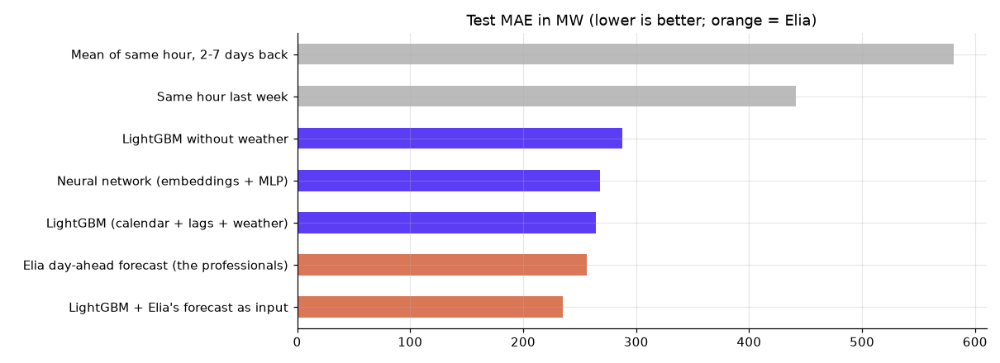
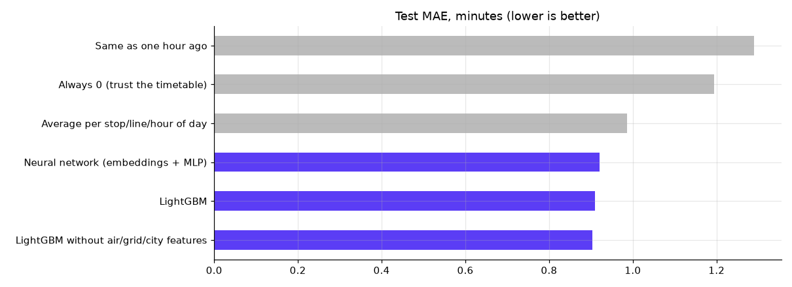
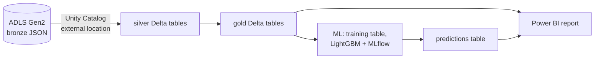

# Brussels transit ML

[](https://github.com/Huntsama/brussels-transit-ml/actions/workflows/ci.yml)

Machine learning on Belgian open data: **beating the grid operator's own electricity forecast** and **predicting
how late Brussels buses, trams and metros run**. Then the same data on an Azure Databricks platform with MLflow,
Kafka streaming and a FastAPI service.

## Results

Every model is tested on later data than it was trained on (time split, no leakage; checked by tests in `tests/`).

**Belgian electricity demand, day ahead** (`grid_load`, Elia data since 2015 + weather). Elia's own forecast is off by
259 MW on average (Mar 2024 to Oct 2026, 22,870 hours). LightGBM that takes Elia's forecast as one input and corrects
it, fed only weather forecasts issued two days ahead (what was really known when Elia published): **241 MW, 7% better**.
With the measured weather of the day (an upper bound nobody has in advance) it is 239 MW. Without Elia's forecast as
input, LightGBM does not beat Elia overall (264 vs 259 MW) but does on public holidays (243 vs 322 MW). Details:
[`outputs/grid_load/fair-comparison.md`](outputs/grid_load/fair-comparison.md).



**Extra wait at each STIB stop, next hour** (`transit_delay`, 1.66M stop-hours, 10 Oct to 14 Nov 2026). Test on the
last 8 days (7 to 14 Nov): LightGBM **0.90 min** mean error vs 0.99 for the best rule (average per stop, line and hour),
**8.5% better**. A rolling backtest on the two most recent weeks gives the same picture: 8.0% and 8.7% better.
The edge was 11% on the first 18 days of data (1.02 vs 1.15): with more history the simple rule improved more than
the model did. Air quality, grid and city features still do not help, so the final model leaves them out.
Details: [`outputs/transit_delay/backtest.md`](outputs/transit_delay/backtest.md), the 18-day run in
[`outputs/transit_delay-18days/`](outputs/transit_delay-18days/).

| Model | MAE (min), 7-14 Nov | backtest, mean of 2 weeks | 18 days (test 23-26 Oct) |
|---|---|---|---|
| Same as one hour ago | 1.290 | 1.263 | 1.374 |
| Always 0 (trust the timetable) | 1.194 | 1.178 | 1.277 |
| Average per stop/line/hour of day | 0.987 | 0.970 | 1.146 |
| Neural network (embeddings + MLP) | 0.921 | not run | 1.053 |
| LightGBM | 0.910 | 0.889 | 1.027 |
| **LightGBM without air/grid/city features** | **0.903** | **0.885** | **1.018** |



Full studies with plots and error analysis: `outputs/<task>/report.html` (download and open) or
`outputs/<task>/notebook.ipynb` (renders on GitHub).

## What is built, what is in progress

| Part | State |
|---|---|
| ML studies (`tasks/`, `outputs/`, `src/mlkit.py`) | done, reproducible with `bash run.sh <task>` |
| Tests + CI (GitHub Actions, images to ghcr.io) | done, green |
| FastAPI service + Kafka producer (`api/`, `streaming/`) | code, tests and Docker images done |
| Databricks platform in Terraform (`infra/`, `notebooks/`) | written; first deployment pending |
| Power BI report | in progress |

## Databricks platform

The data comes from [brussels-lakehouse](https://github.com/Huntsama/brussels-lakehouse): an Azure Function saves
STIB's live waiting times and vehicle positions every 5 minutes, plus air quality (IRCEL) and Belgian grid load
(Elia), into an ADLS Gen2 lake. That repo turns it into tables with dbt on DuckDB and publishes
[lakehouse.jwds.me](https://lakehouse.jwds.me). This repo builds on the same lake with the Databricks stack:



- **Unity Catalog**: catalog `brussels` with schemas `silver`, `gold`, `ml`. Databricks reaches the lake through an
  access connector (a managed identity), no keys.
- **Pipeline** (`notebooks/`): Spark SQL ports of the dbt models, rebuilt every morning by a Databricks job on a
  cluster that exists only while it runs. The job fails if a data check fails.
- **ML on Databricks** (in progress): the transit model trained and tracked in the workspace. Two targets:
  1. *Excess wait* per stop, line and hour: how much longer people wait than the timetable promises.
  2. *STIB's countdown error*: following each vehicle across snapshots, STIB's prediction 5 to 20 minutes ahead is
     off by about 1 minute, and the vehicle comes ~20 s later than shown on average (1.8 M predictions, 13 to 18 Oct).
- **Power BI**: report on the gold tables and the model's predictions.
- **Infrastructure as code**: `infra/main.tf` creates the workspace, the access connector and its role on the lake,
  the Unity Catalog objects, the cluster, the job and the Git folder.

## Live status: batch + streaming (Databricks, Spark, Kafka, FastAPI)

STIB's feed every 20 s → Kafka (Azure Event Hubs) → Spark Structured Streaming on Databricks → `gold.line_status_live`
(normal / slower / disrupted per line, compared with what is usual at that hour) → a FastAPI service and a Power BI report.
Design, trade-offs, costs and setup steps: [`docs/DESIGN.md`](docs/DESIGN.md). Everything explained in plain words with diagrams: [`docs/EXPLAINED.md`](docs/EXPLAINED.md) ([PDF](docs/EXPLAINED.pdf), [draw.io](docs/architecture.drawio)).

| Folder | What |
|---|---|
| `streaming/` | Kafka producer (Docker) |
| `notebooks/03_stream_live_status.py` | Spark streaming job: bronze events + live line status |
| `api/` | FastAPI: `/network/status`, `/lines/{id}`, tests, Docker |
| `infra/streaming.tf` | Event Hubs, Container Apps (producer + API), Databricks secret and job |
| `.github/workflows/ci.yml` | Tests on every push; images to ghcr.io on main |
| `src/mlkit.py` + `infra/main.tf` | MLOps: MLflow tracking, model registry with a champion/challenger gate, weekly retraining job on Databricks |

## How the ML work is organised

```
tasks/<task>/get_data.py    download or export the inputs        -> data/<task>/      (not in git)
tasks/<task>/notebook.py    the study: checks, plots, features, split, baselines, models, error analysis
outputs/<task>/             report.html (read this), notebook.ipynb (with outputs), figures/, metrics.csv
src/mlkit.py                shared helpers: paths, time split, leak-free history, metrics, figures
tests/                      pytest: the split never mixes time, history features never see the future
```

`transit_delay` outgrew one notebook (five weeks of data ran the Jupyter kernel out of memory), so it is a pipeline
of steps with settings in `tasks/transit_delay/config.yaml`; its notebook is now a read-only report over their files:

```
features.sql + features.py  DuckDB builds the model table from the Parquet files -> data/transit_delay/features.parquet
train.py [--nn]             standard split, baselines, LightGBM (+ NN), MLflow with data snapshot id + git commit,
                            champion/challenger gate                -> outputs/transit_delay/train_summary.json
evaluate.py                 metrics.csv, figures 07-10, hardest lines
backtest.py [--nn]          weekly rolling backtest                 -> outputs/transit_delay/backtest.csv, backtest.md
record_history.py           one row per run in history.csv; fails if the gain over the best rule drops below 3%
```

Full run on the desktop (4 cores, i5-2400, ~5.5 GB RAM in WSL): 46 min, peak memory 1.1 GB (train.py); the
notebook alone runs in 10 s and 0.8 GB. The old all-in-one notebook as a script peaked at 2.1 GB, and its Jupyter
kernel was killed for lack of memory. Tests check that the SQL features equal the original pandas ones on the 18-day
snapshot and that changing later data never changes an earlier feature.

**Weekly retrain** (`.github/workflows/retrain.yml`, Monday 06:30 UTC): brussels-lakehouse exports its gold tables
to its static site every Monday 03:30; this workflow downloads them, runs features -> train -> evaluate -> backtest
(LightGBM only), appends a row to `outputs/transit_delay/history.csv` (data snapshot, MAE, gain over the best rule,
backtest mean and spread) and commits the outputs. `record_history.py` fails the run, and GitHub emails, when
LightGBM is less than 3% better than the best simple rule on the newest week: a model that stops beating a rule
should not stay the answer. MLflow stays local (`--no-mlflow` in CI); the history file is the record.

Run one task end to end (CPU is enough): `bash run.sh grid_load` or `bash run.sh transit_delay`. `FETCH=0 bash run.sh
<task>` skips `get_data.py` (use it when the Parquet files were copied in by hand). Tests: `uv run pytest -q tests`.
Colab: `grid_load` as before (open `outputs/grid_load/notebook.ipynb`, upload `src/mlkit.py` and the data files when
asked). `transit_delay` no longer runs from the notebook alone: clone the repo in Colab, put the two Parquet files in
`data/transit_delay/` and run `pip install uv && FETCH=0 bash run.sh transit_delay` (not tried yet).

| Task | Question | Data | Status |
|---|---|---|---|
| `transit_delay` | How many minutes longer than the timetable will people wait at each stop next hour? | lakehouse, 1.66M stop-hours, 10 Oct-14 Nov 2026 | done: LightGBM 0.903 min MAE vs 0.987 best rule (8.5%); backtest 8.0-8.7% |
| `grid_load` | Tomorrow's Belgian electricity demand, hour by hour: can we beat Elia's own forecast? | Elia since 2015 + Open-Meteo weather (measured + archived forecasts) | done: with forecast weather, Elia 259 MW MAE; LightGBM 264; LightGBM correcting Elia 241 (7% better) |

### More projects this data supports (not built yet)

| Idea | Why it is worth it | Data |
|---|---|---|
| Correct STIB's countdown | STIB's "arrives in N min" is off by ~1 min and biased late: learn the correction | lakehouse snapshots (1.8M predictions) |
| NO₂ forecast per station, 24 h ahead | Air-quality alerts; traffic and transit features from the lakehouse | IRCEL history (open API) + weather |
| Disruption detector | Flag a bad hour like Monday 12 Oct as it starts (anomaly detection) | lakehouse, live |
| Grid peak alert | Will tomorrow's peak exceed a threshold? Classification on top of `grid_load` | Elia + weather |
| Solar effect | How much rooftop solar hides from the grid each sunny hour | Elia + radiation |

Power **outages** cannot be predicted from this data: none of these sources records outages. The closest honest
targets are demand peaks and disruption alerts above.

## What the data says so far

A first look at the lakehouse, before any model: on a normal day (13 to 18 Oct 2026) STIB runs under half a minute behind its
timetable (metro +0.47 min, bus +0.39, tram +0.38). Monday 12 Oct was the exception at +4.7 min. A plain average per
stop, line and hour of day predicts Friday's excess wait with a mean error of **0.94 min**, against 1.16 for always
guessing zero. That is the baseline a model has to beat.

## Cost

Azure for Students credit. The workspace costs nothing while idle; the 14-day trial covers Databricks' fees, so a
running cluster costs only its VM (Standard_DS3_v2, ~0.30 EUR/hour), and it stops after 15 idle minutes. The
workspace is created without a NAT gateway (`no_public_ip = false`), which would otherwise bill ~30 EUR a month
with nothing running. The lakehouse's $10/month budget alert covers this too.

## Deploy

```bash
cd infra
cp terraform.tfvars.example terraform.tfvars   # your subscription id
az login
export TF_VAR_github_token=...                  # fine-grained token: Contents read/write on this repo only
terraform init
# the Databricks provider needs the workspace to exist before it can plan the rest
terraform apply -target=azurerm_databricks_workspace.dbw -target=azurerm_role_assignment.connector_writes_lake
terraform apply
```

Then run the job once by hand (`job_url` in the outputs) and compare its row counts with the DuckDB build.

## Status

- [x] Terraform: workspace, access connector, Unity Catalog, cluster, job, Git folder
- [x] Silver and gold as Spark SQL notebooks, with data checks
- [ ] Deployed, first job run matches the DuckDB row counts
- [ ] Power BI report on gold and predictions
- [ ] When the trial ends: `sku = "premium"`
