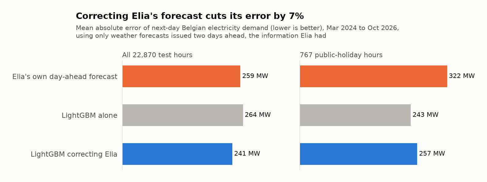
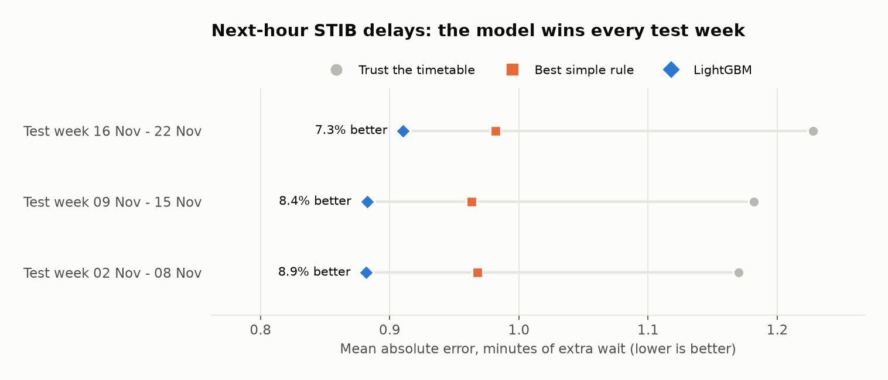
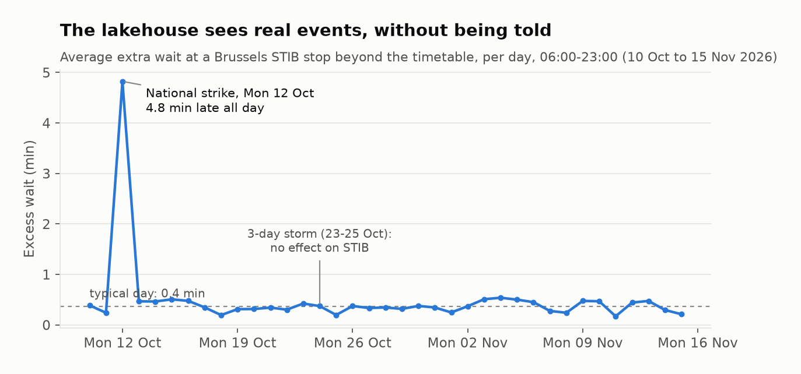
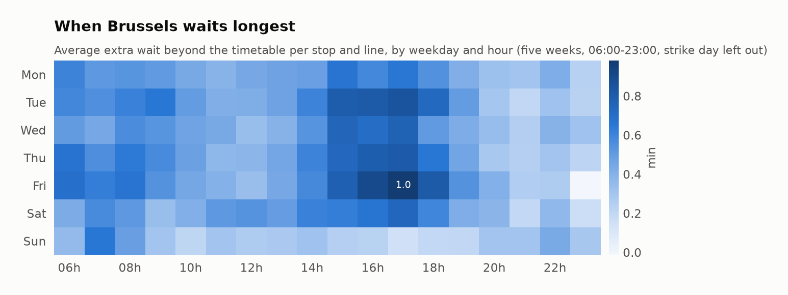
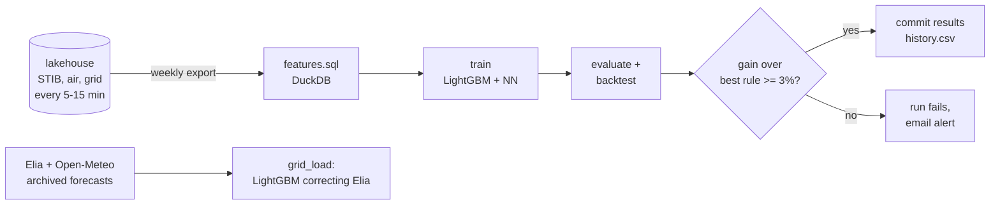

# Brussels transit ML

[](https://github.com/Huntsama/brussels-transit-ml/actions/workflows/ci.yml)
[](https://github.com/Huntsama/brussels-transit-ml/actions/workflows/retrain.yml)

Machine learning on Belgian open data: **correcting the grid operator's electricity forecast** and **predicting how
late Brussels buses, trams and metros run**, on data my own [lakehouse](https://github.com/Huntsama/brussels-lakehouse)
collects every 5 minutes. Every model is tested on later data than it was trained on, against honest baselines.

## Beating Elia's day-ahead forecast

<picture>
  <source media="(prefers-color-scheme: dark)" srcset="docs/img/readme-elia-dark.png">
  
</picture>

LightGBM takes Elia's own forecast as one input and corrects it, using only weather forecasts issued two days ahead,
so it knows nothing Elia did not. Over 22,870 unseen hours it is **7% more accurate than Elia**. On its own it does
not beat Elia overall, but it does on public holidays, where Elia's error jumps. Method and limits:
[fair comparison](outputs/grid_load/fair-comparison.md).

## Predicting STIB delays, week after week

<picture>
  <source media="(prefers-color-scheme: dark)" srcset="docs/img/readme-backtest-dark.png">
  
</picture>

For every stop and line, how much longer than the timetable will people wait next hour? On 1.7M stop-hours, LightGBM
beats the best simple rule (an average per stop, line and hour) by **8.5%**, and by 8.5% and 9.2% on two separate
test weeks. It retrains every Monday on fresh data; the run fails, and I get an email, if it ever stops beating the
rule by 3%. Air quality and grid load add nothing once the daily rhythm is known, so the final model leaves them out.

## What the data shows

<picture>
  <source media="(prefers-color-scheme: dark)" srcset="docs/img/readme-strike-dark.png">
  
</picture>


<picture>
  <source media="(prefers-color-scheme: dark)" srcset="docs/img/readme-heatmap-dark.png">
  
</picture>


## How it works



Python, DuckDB SQL, LightGBM, PyTorch, MLflow, pytest, GitHub Actions. Tests check that no feature ever sees the
future and that the SQL features match the original pandas ones exactly.

```bash
uv sync
bash run.sh grid_load                 # or: FETCH=0 bash run.sh transit_delay
uv run pytest -q tests
```

## More

- [docs/DETAILS.md](docs/DETAILS.md): full results tables, the Databricks platform (Terraform, Unity Catalog, written
  but not yet deployed), live status with Kafka and FastAPI, cost, deployment, ideas.
- [docs/EXPLAINED.md](docs/EXPLAINED.md): the whole project in plain words, with diagrams.
- Full studies with every plot: `outputs/<task>/notebook.ipynb`.
