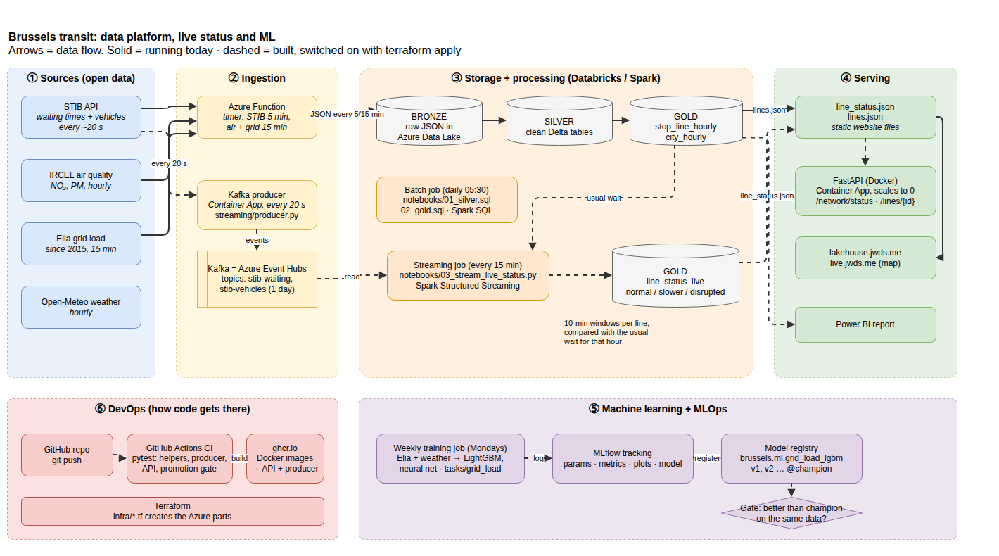
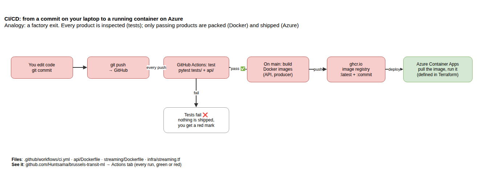
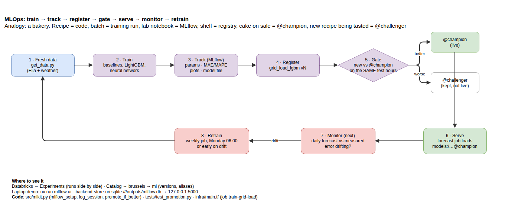

# Brussels transit: everything explained

What this project is, every technology in it in plain words, how the pieces work together, where each one lives
in the code, how to run it, and how to talk about it in an interview.
Diagrams: `docs/architecture.drawio` (open in draw.io or app.diagrams.net → File → Open from → Device).

---

## 1. The project in one minute

Brussels' public transport company, STIB, publishes live data: when the next tram, bus or metro arrives at every
stop, refreshed about every 20 seconds. It keeps no history. This project:

1. **collects** that feed (plus air quality, electricity demand and weather) into a data lake on Azure;
2. **cleans** it into tables in three layers (bronze, silver, gold);
3. **shows live status** per line (normal / slower / disrupted) compared with what is usual at that hour;
4. **learns** from history with machine learning (transit delays, Belgian electricity demand);
5. **ships** all of it the professional way: tests, Docker, CI/CD, infrastructure as code, MLOps.

**What it found:**

- On a normal day STIB runs ~20 seconds behind its timetable.
- On **12 October 2026, a national strike**, the whole network ran 4.4 minutes late all day. The data caught it
  without being told; a 3-day storm (23-25 Oct) did *not* slow STIB down.
- A model predicts next hour's delay per stop **11% better** than the best simple rule.
- For electricity, the model comes within 0.15 points of Elia's professional forecast and, used as a correction
  layer on Elia's forecast, **beats it by 8%**.

---

## 2. Every technology, in plain words

Each one: **what it is**, an **analogy**, and **where it is in this project**.

### Data lake (Azure Data Lake Storage Gen2)
- **What:** cheap cloud storage for huge amounts of files.
- **Analogy:** a warehouse where every delivery is kept in its original box.
- **Here:** `belakehouselake` on Azure. Every STIB snapshot (5 min), air quality and grid load (15 min) since 9 October.

### Bronze / silver / gold (the "medallion" layers)
- **What:** three stages of the same data.
    - 🥉 **Bronze**: raw, exactly as received.
    - 🥈 **Silver**: cleaned, with proper types and times.
    - 🥇 **Gold**: ready to use for charts and models.
- **Analogy:** raw ingredients → washed and cut → the finished dish.
- **Here:**
    - bronze = JSON files in the lake;
    - silver = `stib_waiting`, `gtfs_departures`…;
    - gold = `stop_line_hourly` (extra wait per stop, line and hour) and `line_status_live`.

### Azure Function
- **What:** a small piece of code Azure runs on a timer. No server to manage; you pay per run (almost nothing).
- **Analogy:** an alarm clock that does one job each time it rings.
- **Here:** in the `brussels-lakehouse` repo, it saves STIB every 5 minutes and air + grid every 15 minutes. **Running today.**

### dbt + DuckDB (today's batch processing)
- **What:**
    - DuckDB is a fast database that runs inside Python, with no server.
    - dbt builds tables from SQL files in the right order, with tests.
- **Analogy:** a recipe book (dbt) and a kitchen counter (DuckDB), enough for one cook.
- **Here:** `brussels-lakehouse/transform`, with 27 data tests. Builds the public dashboard every hour.

### Kafka (on Azure: Event Hubs)
- **What:** a system that receives a non-stop stream of events and **holds them** until programs read them.
- **Analogy:** a conveyor belt that keeps parcels until someone picks them up.
- **Words to know:**
    - **producer**: puts events on the belt;
    - **topic**: a named belt;
    - **consumer**: takes events off;
    - **partition**: parallel lanes of one topic;
    - **offset**: the consumer's bookmark;
    - **retention**: how long events are kept.
- **Why here:** STIB changes every 20 s, the lake keeps only every 5 min, and Spark doesn't run all the time (to
  save money). Kafka buffers every reading so Spark can switch on, catch up, and switch off, with nothing lost or
  read twice.
- **Here:**
    - `streaming/producer.py` sends ~3,000 events every 20 s to the topics `stib-waiting` and `stib-vehicles`.
    - `infra/streaming.tf` creates Event Hubs.

### Spark (PySpark) and Structured Streaming
- **What:** an engine that processes data too big for one machine by splitting the work over many cores or
  machines. You write Python (PySpark) or SQL on tables called DataFrames.
  **Structured Streaming** is the same, for data that keeps arriving.
- **Analogy:** a kitchen with many cooks splitting one huge order.
- **Words to know:**
    - **window**: e.g. 10-minute buckets;
    - **watermark**: "readings later than 10 minutes are ignored", so a window can be finished;
    - **checkpoint**: Spark's bookmark;
    - **availableNow**: process what's waiting, then stop.
- **Here:**
    - `notebooks/01_silver.sql` and `02_gold.sql`: batch, the same logic as dbt.
    - `notebooks/03_stream_live_status.py`: reads Kafka, saves every reading, and computes per line and 10-minute
    window the wait vs the usual wait at that hour, then labels it normal / slower / disrupted.

### Databricks
- **What:** a cloud platform to run Spark: notebooks, clusters (machines), scheduled jobs, MLflow, and Unity
  Catalog (the list of tables and who may use them).
- **Analogy:** the restaurant building that holds the kitchen, the staff rota and the storeroom.
- **Here:**
    - Workspace, cluster, catalog `brussels` (schemas bronze/silver/gold/ml) and 3 jobs: daily batch, streaming
    every 15 min, weekly training.
    - All of it is in `infra/main.tf`. **Built; switched on with `terraform apply`.**

### Delta Lake
- **What:** a table format on top of files in the lake: safe updates, schema checks, and *time travel* (read a
  table as it was last week).
- **Analogy:** turning a pile of paper files into a proper filing cabinet with a history log.
- **Here:** every Databricks table (`bronze.stib_waiting_events`, `gold.line_status_live`…).

### FastAPI (the backend)
- **What:** a Python tool to build an **API**, a door other programs knock on to get data as JSON. It writes its
  own documentation page (`/docs`).
- **Analogy:** a shop counter: you ask, it answers.
- **Here:** `api/app.py`, with 3 doors:
    - `/health`;
    - `/network/status`: is Brussels normal or disrupted?
    - `/lines/71`: one line now, plus its usual delay for every hour.
- **Two details worth saying in interviews:** it caches answers for 60 seconds, and if storage is down it serves
  the last good copy instead of crashing. 6 tests in `api/test_app.py`.

### Docker
- **What:** packs a program **with everything it needs** into an *image*; a running image is a *container*.
- **Analogy:** a shipping container: same box on any ship.
- **Here:** `api/Dockerfile` and `streaming/Dockerfile`.

### Azure Container Apps
- **What:** runs Docker containers in the cloud. Can **scale to zero**: no requests, no cost.
- **Here:** `stib-producer` (always 1 small container) and `transit-api` (0 when idle). In `infra/streaming.tf`.

### Git, GitHub, CI/CD (GitHub Actions)
- **What:**
    - Git keeps the history of the code (commits); GitHub is the online copy.
    - **CI** = every push runs the tests automatically.
    - **CD** = when they pass, the new version is packaged and shipped.
- **Analogy:** the quality inspector at the factory exit.
- **Here:** `.github/workflows/ci.yml`.
    - Every push runs the tests: ML helpers, the producer's data handling, the API, and the promotion gate.
    - On `main`, it builds both Docker images and publishes them to `ghcr.io`.
    - See every run under the repo's **Actions** tab.

### Terraform (infrastructure as code)
- **What:** you describe the cloud setup in text files; `terraform apply` creates it, `terraform destroy`
  removes it. Repeatable and reviewable, with no clicking in the portal.
- **Analogy:** an architect's blueprint: the same building, again, from the plan.
- **Here:**
    - `infra/main.tf`: Databricks, catalog, jobs.
    - `infra/streaming.tf`: Event Hubs, Container Apps, secret.

### Power BI
- **What:** Microsoft's dashboard tool, widely used by business teams in Belgium.
- **Here:** connects to the gold tables. Steps are in `docs/DESIGN.md`; it needs Windows or a VUB account on
  app.powerbi.com.

### Machine learning words
- **Model:** a program that learns patterns from past data to predict new cases.
- **Baseline:** a simple rule ("same as last week"). A model only counts if it beats it.
- **LightGBM:** hundreds of small decision trees, each fixing the previous ones' mistakes. Usually the best on tables.
- **Neural network:** layers of simple calculations. Strong for text and images; on tables it usually ties with
  or loses to LightGBM, as it did here.
- **Embedding:** a small learned vector per category (each stop, line, hour), like word embeddings in NLP.
- **MAE:** the average error, in minutes or MW. **MAPE:** the same as a percentage.
- **Split by time:** train on the past, test on later days, never shuffled. Otherwise the model remembers instead
  of predicting.
- **Leakage:** a feature that wouldn't be known at prediction time. It makes a model look brilliant and then fail.
- **Here:**
    - `tasks/transit_delay`: next hour's extra wait per stop.
    - `tasks/grid_load`: tomorrow's Belgian electricity demand vs Elia.
    - Reports in `outputs/<task>/report.html`.

### MLOps and MLflow
- **MLOps** is DevOps for models: everything needed so a model keeps working **after** it was made.
- **Analogy:** a bakery.
    - The recipe is the code; each batch is a training run.
    - The lab notebook is MLflow tracking; the display shelf is the registry.
    - The cake on sale is `@champion`; a new recipe being tasted is `@challenger`.
    - A new cake goes on sale only if it wins a blind tasting on the same plate.
- **MLflow tracking:** every run records parameters, metrics, plots and the model file; you compare runs side by side.
- **Model registry:** named models with versions (v1, v2…) and aliases. The live code always loads `@champion`,
  so switching or rolling back is a registry change, not a code change.
- **The promotion gate:** a new version becomes champion **only if it beats the current champion on the same
  data**. Code: `src/mlkit.py` → `promote_if_better`; tested in `tests/test_promotion.py`.
- **Automation:** the Databricks job `train-grid-load` retrains every Monday. It is created paused.
- **Monitoring** (next step): compare each day's forecast with reality and retrain early when the error drifts.

---

## 3. The workflow, start to finish

| # | Step | What happens | Status |
|---|---|---|---|
| ① | Collect | Azure Function saves STIB, air and grid to the lake (5/15 min); the producer streams STIB to Kafka (20 s) | Function **running**; producer built |
| ② | Clean | Spark (or dbt) turns bronze into silver and gold tables | dbt **running**; Databricks built |
| ③ | Live status | Streaming job: 10-minute windows per line vs usual → `line_status_live` → `line_status.json` | built; **demo ran** on live data |
| ④ | Serve | FastAPI → website, apps; Power BI on gold | API built, **demo ran locally** |
| ⑤ | Learn | Weekly job: fresh data → train baselines, LightGBM, neural net | notebooks **ran**; job built |
| ⑥ | Decide | MLflow logs everything; the gate promotes only a better model | built; **MLflow UI shown** with real scores |
| ⑦ | Ship code | push → tests (CI) → Docker images → Azure | **running** (green on GitHub) |
| ⑧ | Watch | forecast vs reality, alert on drift, retrain early | next step |

---

## 4. What was done on 27 October 2026

1. Downloaded all collected data (9-27 Oct) from Azure: 810 MB, >99.7% of snapshots present.
2. **Fixed a lakehouse bug:** only the newest weekly timetable was used, so every day before 26 Oct vanished from
   the delay tables. Now each day uses its own week's timetable (835k stop-hours instead of 80k).
3. Transit delay study: correlations, LightGBM, neural network, error analysis.
4. Electricity demand study on 11 years of Elia data, vs Elia's own forecast.
5. Reorganised the ML repo into `tasks/`, `outputs/`, `src/`, `tests/`.
6. Fixed **"Show near me"** on live.jwds.me: it now updates when a precise location arrives.
7. Built streaming (Kafka producer, Spark job), the FastAPI backend, Docker, CI/CD, Terraform, `docs/DESIGN.md`.
8. Added MLOps: MLflow tracking, model registry, promotion gate with tests, weekly retraining job.
9. Demos: live line status on STIB's current data (68 lines normal, 29 and 71 disrupted at 21:03); the MLflow UI.

---

## 5. How to run each part

| What | Command (in `brussels-transit-ml`) |
|---|---|
| Live status demo (one reading, ~1 s) | `uv run python demo/live_demo.py` |
| The API locally | `cd api && uv run --no-project --with fastapi,uvicorn,httpx uvicorn app:app` → 127.0.0.1:8000/docs |
| MLflow page | `uv run mlflow ui --backend-store-uri sqlite:///outputs/mlflow.db` → 127.0.0.1:5000 |
| A full ML study (on a strong machine or Colab) | `bash run.sh grid_load` or `bash run.sh transit_delay` |
| Tests | `uv run pytest -q tests` and `cd api && pytest -q` (GitHub runs both on every push) |
| Everything on Azure | `docs/DESIGN.md` → "Your steps" (`terraform apply`, then run the jobs) |
| Redraw the diagrams | `python3 docs/make_diagrams.py` |

**Costs on the student credit:**

- Kafka (Event Hubs) ~22 €/month and the producer ~5 €/month, while streaming is on.
- The API is ~0 € (it scales to zero).
- Databricks: ~0.30 €/hour of machine while a job runs.
- Remove the streaming part after the demo period with the `terraform destroy` command in `DESIGN.md`.

---

## 6. Interview answers

**"Walk me through a project."**
> "I built a data platform on Brussels public transport. A 5-minute batch lands in an Azure data lake, and a
> 20-second stream goes through Kafka on Event Hubs. Spark on Databricks builds bronze, silver and gold Delta
> tables and computes each line's live status against its usual delay for that hour. A FastAPI service serves it,
> packaged with Docker and shipped by GitHub Actions, with the infrastructure in Terraform. It caught the
> 12 October national strike from the data alone."

**"Why Kafka and not just a database?"**
> "The source never stops and the consumer doesn't run all the time, to save cost. Kafka buffers the events and
> Spark keeps a checkpoint, so it can catch up after being off without losing or duplicating anything. New
> consumers, like an alerting service, can read the same stream independently."

**"How do you do MLOps?"**
> "Training runs weekly on Databricks. MLflow tracks every run's parameters, metrics and artifacts. Models are
> versioned in the registry with a champion/challenger gate: a new model is only promoted if it beats the live one
> on the same data, and that gate is unit-tested. Next is monitoring, to catch drift."

**"What didn't work?"**
> "Air quality and grid load didn't improve transit predictions: removing them made the model slightly better. And
> my first version silently lost all history when a new timetable arrived; I found it because a table suddenly
> had 2 days instead of 18, and fixed it so each day uses its own timetable."

**"Trees or neural networks?"**
> "On this tabular data LightGBM beat the neural network in both tasks (1.018 vs 1.053 min; 264 vs 268 MW). The
> network needs more data and tuning for little gain here. I'd pick the neural network for text, images or
> sequences."
